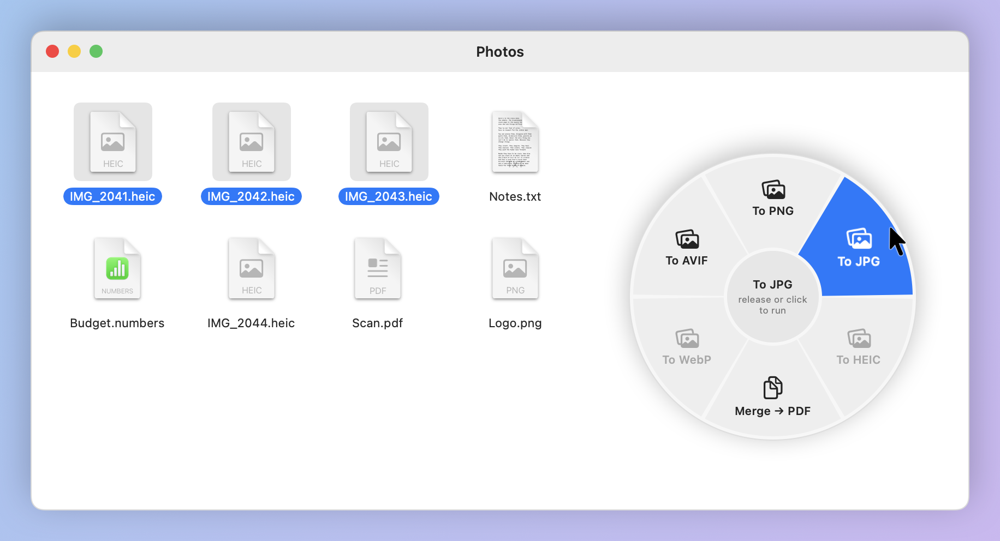
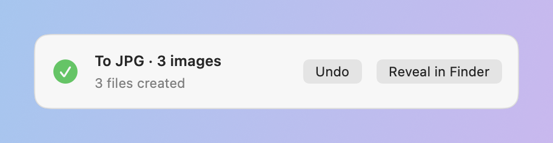
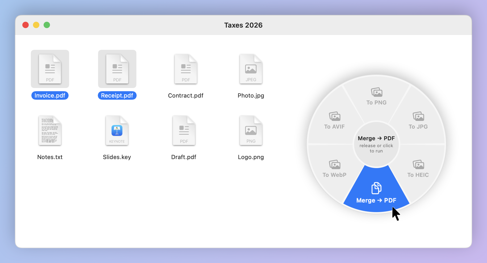
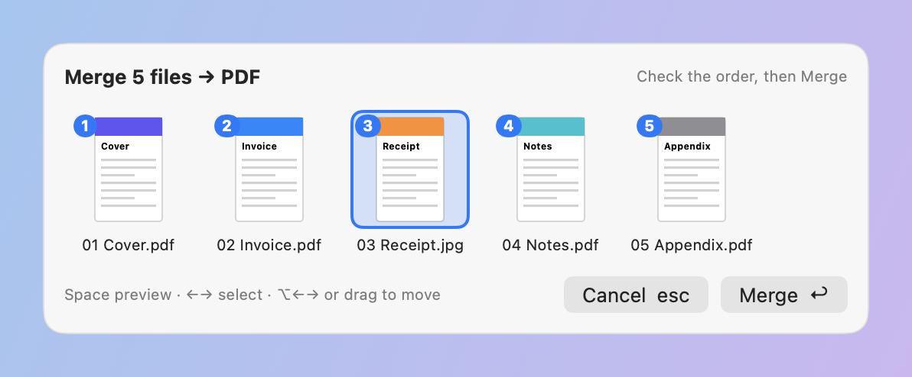
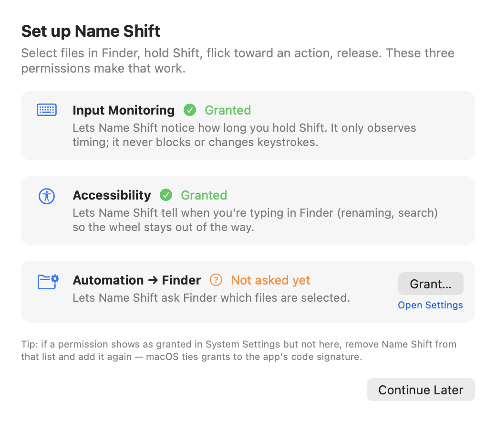

# Name Shift

**Convert and merge files in about a second, without opening an app.**
Select files in Finder, hold <kbd>Shift</kbd>, flick toward an action, let go.

<picture>
  <source media="(prefers-color-scheme: dark)" srcset="docs/images/wheel-convert-dark.png">
  
</picture>

Name Shift is a macOS menu-bar app. Hold Shift for a moment with files selected in Finder,
and a radial wheel appears at your cursor showing only the actions that make sense for those
files. Point at one and release Shift (or click it). The result is saved next to the original,
and the original is never overwritten.

## How it works

1. **Select** one or more files in Finder (a window or the Desktop).
2. **Hold Shift** for about 300 ms without pressing anything else. The wheel opens at the cursor.
3. **Flick** toward a slice: direction is what counts, so a short flick is enough.
   Scrolling also rotates the selection.
4. **Release Shift** or **click** the slice to run it. Releasing in the center, pressing
   <kbd>Esc</kbd>, or clicking outside the wheel cancels.

A small toast shows progress, then **Reveal in Finder** and **Undo** (Undo moves the new files
to the Trash).

<picture>
  <source media="(prefers-color-scheme: dark)" srcset="docs/images/hud-dark.png">
  
</picture>

### It stays out of the way while you type

Shift is used constantly, so the wheel only opens when **all** of these hold:

- Shift was held on its own for the full hold time: no other key, click, scroll or drag in between.
  Typing capitals and Shift-click multi-select never trigger it.
- Finder is the frontmost app and at least one file is selected.
- You're not typing in Finder (renaming a file, the search field) and no mouse button is held.

The **Debug Log** (menu bar → Debug Log…) records why each hold did or didn't open the wheel.

## Actions

The wheel always has the same six slices. Ones that don't apply to your selection are greyed
out, and hovering one shows why.

| Slice | What it does |
|---|---|
| **To PNG / JPG / HEIC / AVIF** | Converts each selected image, keeping metadata and orientation. Transparent images going to JPG get a white background. |
| **Merge → PDF** | Combines 2+ PDFs and/or images into one PDF, in an order you confirm first (see below). |
| **To WebP** | Not available yet: macOS can read WebP but can't write it. Coming with libvips. |

<picture>
  <source media="(prefers-color-scheme: dark)" srcset="docs/images/wheel-merge-dark.png">
  
</picture>

### Checking the merge order

Finder doesn't tell other apps the order you clicked files in, so merges start in filename order
(Finder-style, so “page 2” comes before “page 10”). A tray lets you check and fix it before
anything is written. It waits until you press Merge.

<picture>
  <source media="(prefers-color-scheme: dark)" srcset="docs/images/merge-tray-dark.png">
  
</picture>

| Key | Action |
|---|---|
| <kbd>Space</kbd> | Preview the selected file inside the tray (multi-page PDFs scroll) |
| <kbd>←</kbd> <kbd>→</kbd> | Select the previous or next file |
| <kbd>⌥←</kbd> <kbd>⌥→</kbd> or drag | Move the selected file earlier or later |
| <kbd>Return</kbd> / <kbd>Esc</kbd> | Merge / close the preview, then cancel |

### Output rules

- Files are written **next to the original**: `photo.heic` → `photo.jpg`; merges are named
  `<first file> merged.pdf`.
- **Nothing is ever overwritten.** If the name is taken you get `photo 2.jpg`, `photo 3.jpg`, …
  (checked atomically at write time).
- **Undo** (toast or menu bar) moves the last job's outputs to the Trash. Nothing is deleted
  outright. If you cancel a job partway, the files already written are kept and Undo still
  covers them.

## Install

Requires **macOS 14 Sonoma or later** and Xcode 15+ (Swift 5.10) to build. There's no
prebuilt download yet.

```bash
git clone https://github.com/dhruva-bhat/name-shift.git
cd name-shift
scripts/run.sh
```

`run.sh` builds `build/NameShift.app`, signs it, and launches it. Look for the ⊚ icon in the
menu bar; there's no Dock icon.

### Permissions

On first launch a setup window walks you through three permissions and checks them live:

<picture>
  <source media="(prefers-color-scheme: dark)" srcset="docs/images/onboarding-dark.png">
  
</picture>

| Permission | Why |
|---|---|
| **Input Monitoring** | To notice how long Shift is held. Name Shift only observes; it never blocks or changes keystrokes. |
| **Accessibility** | To tell when you're typing in Finder, so the wheel stays away. |
| **Automation → Finder** | To ask Finder which files are selected. |

> [!IMPORTANT]
> macOS ties these permissions to the app's code signature. Without a signing certificate each
> build is signed ad-hoc with a new signature, and macOS quietly drops the grants after every
> rebuild. Create a stable certificate once: **Keychain Access → Certificate Assistant → Create a
> Certificate…**, name it `NameShift Dev`, type **Code Signing**. `scripts/build-app.sh` picks it
> up automatically (or set `SIGN_IDENTITY`). To clear stale entries:
> `tccutil reset All dev.nameshift.NameShift`.

## Preferences

Menu bar → Preferences… to change:

- **Trigger:** Shift, Option + Shift, or Fn / Globe. For Fn, set System Settings → Keyboard →
  “Press 🌐 key to” → Do Nothing.
- **Hold duration:** 200–800 ms (default 300).
- Trackpad **haptic tick** and optional **tick sound** when the hovered slice changes.
- **Pause** (also in the menu bar menu).

## Development

```bash
swift test                         # core logic tests, no UI or permissions needed
scripts/run.sh                     # build, sign, relaunch the app
CONFIG=release scripts/build-app.sh
scripts/render-readme-images.sh    # regenerate the images in this README
```

The images above are rendered from the app's real SwiftUI views by
`NameShift --render-readme-images <dir>`. The Finder window behind the wheel is a drawn
mock-up.

| Path | Contents |
|---|---|
| `Sources/NameShiftCore` | All logic, unit-tested without UI: the hold-trigger state machine and gate, wheel geometry, actions, ImageIO converter, PDFKit merger, job queue, never-overwrite output policy, undo |
| `Sources/NameShift` | Thin AppKit/SwiftUI layer: listen-only event tap, Finder AppleScript, the wheel / merge tray / toast panels, menu bar, onboarding, preferences, debug log |
| `Tests/NameShiftCoreTests` | Trigger, gate, registry, output naming, merge order, geometry, undo/cancel, and real ImageIO/PDFKit round trips |

The app isn't sandboxed (it needs to read and write files other apps own), so it can't go on
the Mac App Store. It's meant for Developer ID distribution.

## Roadmap

- **Next:** ffmpeg / pandoc / qpdf / libvips (WebP, video, audio, documents), a wheel that
  adapts to the selection, nested rings (Convert → PNG / JPG / …), richer progress and cancel.
- **Then:** presets and chains (e.g. *Resize 1600px → WebP → Zip*), a history and undo UI, and a
  wheel editor.
- **Later:** selections from other apps (Mail attachments, downloads), Shortcuts, automatic
  updates.
